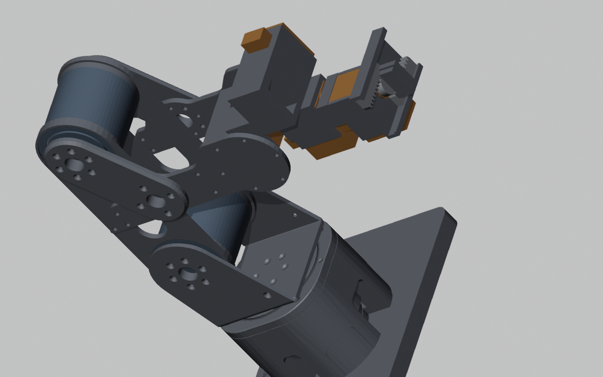
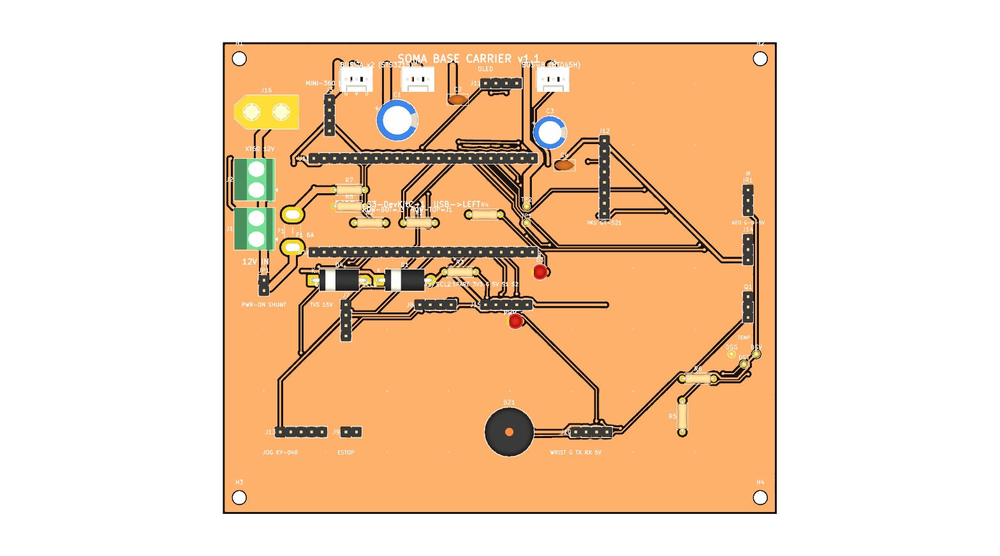
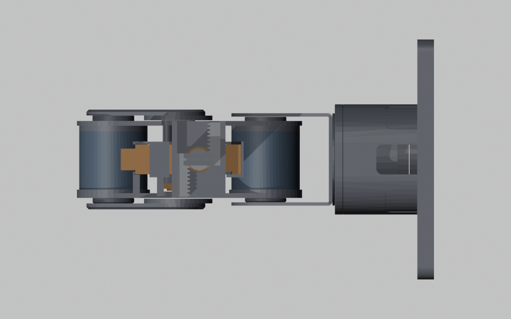
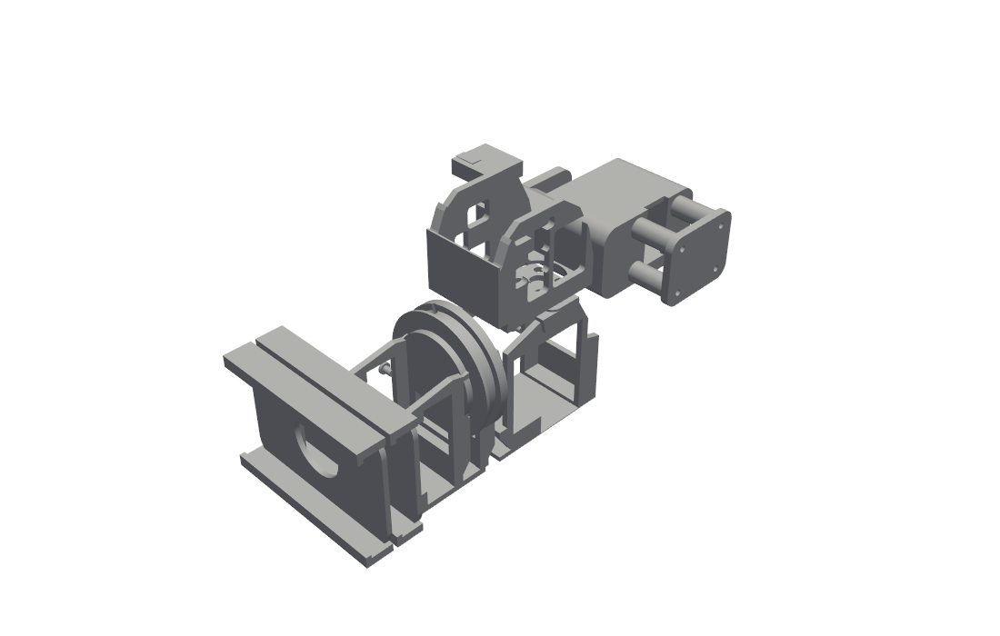
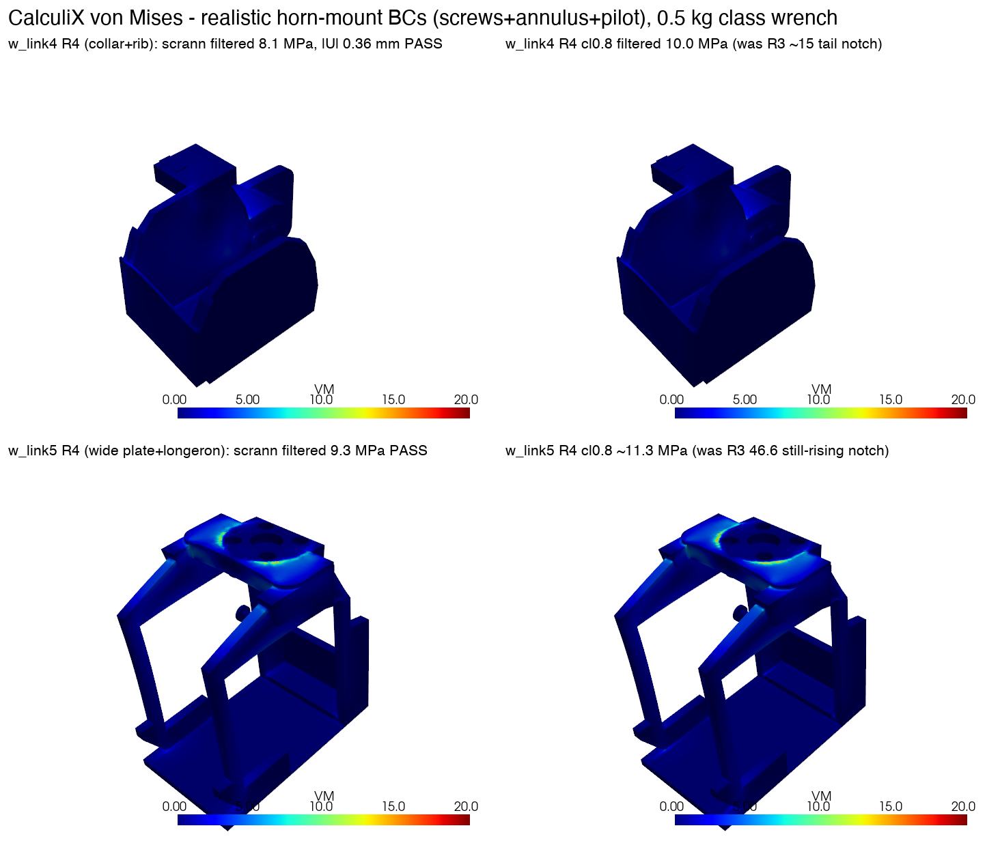

# SOMA — a 6-DOF printed robot arm with printed cycloidal actuators

SOMA is a desk-scale robotic arm (6 joints + parallel-jaw gripper) designed
to be driven by software — a script or an agent — over a documented serial
protocol and Python API. The structure is 3D-printed PETG-CF, and the two
heavily loaded joints (shoulder J2, elbow J3) run on **printed 40:1 cycloidal
reducers** driven by brushless motors — the parts that normally force a
desktop arm onto expensive metal gearboxes. Everything in the repo is
parametric: the mechanical CAD is build123d Python, the carrier PCB is
generated by a Python script into a KiCad project, and the verification
reports are generated by the analysis code in `fullcheck/`.

The design is laid out at ~0.48× scale on Seeed's reBot-DevArm joint plan
(CERN-OHL-W-2.0 — see `NOTICE.md` files), re-engineered around commodity
Feetech bus servos and the printed actuators.



*(Render shows the previous wrist revision; the current R9 wrist is below.)*

## What it does

- **Moves**: 6 joints + gripper, ~0.36 m max level-tool reach, ~1.1 kg
  modelled arm mass on a 140×200 mm desk-mount base.
- **Rated payload 0.25 kg** — verified on paper to a safety factor of 2 in
  every pose, including rolled/edge cases, by per-part FEA (minimum
  converged binding margin SF 3.22; see Verification below). Headroom is
  ~0.35 kg peak — it is honestly a 0.25 kg machine, not a 0.5 kg one.
- **Printed cycloidal actuators**: J2/J3 use 40:1 cycloidal modules —
  PETG-CF discs and housings rolling on hardened ISO 8734 steel dowel pins
  (41× Ø3×10 ring pins + 6× Ø3×12 output pins + 3× Ø4×8 locating pins per
  module), Tarot TL2955 4008 330KV motors, ST B-G431B-ESC1 drivers running
  SimpleFOC, AS5600 magnetic encoders, CAN bus at 1 Mbps. Every printed part
  fits a Bambu A1's 256³ bed.
- **Hard torque + safety limits**: joint torque caps are clamped in the ESCs
  themselves (J2 3.0 N·m, J3 2.0 N·m) and in the trajectory planner; a
  switched motor rail (`MOTOR_EN` relay) means motors get no power until the
  host explicitly arms, and a hardware NC e-stop loop drops the rail
  regardless of firmware state.
- **Agent/script interface**: a framed serial host protocol
  (`docs/host-protocol.md`) plus a pure-Python control package
  (`software/robot-os`) with FK/IK, a torque-gated planner, a gravity/payload
  model and a protocol-level simulator — runnable with no hardware attached.

## Actuator map

| Joint | Function | Actuator | Bus |
|---|---|---|---|
| J1 | base yaw | Feetech STS3250 (50 kg·cm stall, 12 V TTL) | Feetech bus A, 1 Mbaud |
| J2 | shoulder | Tarot 4008 + 40:1 printed cycloidal, B-G431B-ESC1 | CAN 1 Mbps, node 2 |
| J3 | elbow | Tarot 4008 + 40:1 printed cycloidal, B-G431B-ESC1 | CAN 1 Mbps, node 3 |
| J4 | wrist pitch | Feetech STS3250 (printed cradle + U-yoke second bearing) | Feetech bus A |
| J5 | wrist yaw | Feetech STS3215 (30 kg·cm class) | Feetech bus A |
| J6 | tool roll | Feetech STS3215 | Feetech bus A |
| Grip | parallel jaw | Feetech STS3215, rack-and-pinion (steel m1 16T pinion + printed racks), 25 mm stroke | Feetech bus A |

J2 and J3 also carry coaxial one-way torsion balance springs
(Springmasters 471671) that unload the motors in forward poses.

## Current specs

| | |
|---|---|
| Axes | 6 joints + parallel-jaw gripper |
| Rated payload | **0.25 kg** — SF ≥ 2 in every pose (see [FULLCHECK.md](FULLCHECK.md)); ~0.35 kg peak headroom |
| Reach | ~0.36 m max (level tool); home TCP at (233.8, 0, 199.2) mm |
| Arm mass | ~1.116 kg modelled (wrist + gripper 0.240 kg) |
| Joint limits | J1 ±150° (printed hard stop ±152.5°), J2 −120…+70°, J3 −180…+30°, J4 ±70°, J5 ±70°, J6 ±180° (auto-sublimited to ±110° when J5 < 0) |
| J2/J3 torque | capped 3.0 / 2.0 N·m in firmware (worst static demand at 0.25 kg: 2.48 / 1.26 N·m); cyclo structural bound ~3.65 N·m |
| Servos | 2× Feetech STS3250 (J1, J4) + 3× STS3215 (J5, J6, gripper), one shared 12 V TTL bus |
| Cycloidal module | 40:1, dual 4.25 mm PETG-CF discs, Ø44.7 mm; ~57×57×54 mm housing; ISO 8734 steel dowels; AS5600 on motor shaft (hard-stop homing each boot) |
| Controller | ESP32-S3-DevKitC-1 on a custom 2-layer carrier PCB (`soma-carrier-v13`) |
| Motor drivers | 2× ST B-G431B-ESC1 (SimpleFOC, CANopen-style protocol) |
| Power | 12 V / 8.5 A Mean Well RS-100-12 mains PSU; 6 A fuse; reverse-polarity protection; switched motor rail via relay K1 |
| Structure | FDM PETG-CF, every part ≤ 200 mm on a Bambu A1 (256³) bed; full print list ≈1.2 L solid — one 1 kg spool covers it |
| Est. build cost | **£674** verified+priced lines / **£825** all-in incl. unverified estimates (GBP, UK suppliers, Nov 2026 — [BOM](final/BOM_FINAL.md)) |
| Status | **Design verified on paper — not yet built.** Whole-arm check verdict: READY TO ORDER at 0.25 kg |

## The base carrier PCB (`soma-carrier-v13`)

One custom board in the base replaces the usual servo-hub + wire ratsnest:

- **ESP32-S3-DevKitC-1 drops into pin sockets** — it is the only MCU in the
  base; everything on the board is hand-solderable (all through-hole except
  one SOIC-8).
- **Power**: 12 V input (XT60 or screw terminal) → reverse-polarity P-FET
  → 6 A fuse → +12 V rail for the five bus servos (KK-254 keyed
  connectors); optional Mini-360 buck for the 5 V logic rail with a
  Schottky USB/board OR-ing so the devkit can stay plugged in.
- **Switched motor rail**: `MOTOR_EN` (IO40) → 2N2222A → Songle SRD-12V
  relay K1 → `+12V_MOT` on two Phoenix outputs feeding the J2/J3 ESCs. The
  relay coil runs through a **J19 NC e-stop loop** — a twist-release
  mushroom cuts the motor rail in hardware, independent of firmware.
- **CAN onboard**: TJA1051T/3 transceiver + CAN header to the two
  B-G431B-ESC1 joint drivers (1 Mbps; far-end termination on the last ESC).
- **Peripherals on board**: SSD1306 OLED socket, MPU6050 IMU socket, EC11
  jog-dial port, WS2812 port, buzzer, IR receiver, DS18B20 temp sensor,
  12 V rail voltage-sense divider, status/power LEDs, test pads.
- **135×115 mm, 2 layers** (F.Cu + B.Cu ground pours), generated
  parametrically by `gen_pcb.py` (parts placed by coordinate, nets routed
  by a grid A\* router) and opened in KiCad 10.

**Fabrication files**: [`order/pcb13_fix/`](order/pcb13_fix/) holds the
orderable v1.3 board (`soma-carrier-v13.kicad_pcb` — a fixed copy; the v1.3
relay pad map was corrected after a datasheet cross-check) and its
[`gerbers/`](order/pcb13_fix/gerbers/) (2-layer, 1.6 mm, HASL lead-free,
1 oz — see [`order/PCB_ORDER.md`](order/PCB_ORDER.md)). Latest DRC: **0
electrical violations, 0 unconnected** (27 benign silkscreen/library
cosmetic notes only). The `pcb/` folder is the older v1.1 board — kept for
history, do not order from it.



*(Image is the earlier v1.1 board; v1.3 adds the K1 motor-rail relay,
reverse-polarity FET and TJA1051 CAN transceiver on the same outline.
Orderable gerbers: `order/pcb13_fix/gerbers/`.)*

## Electronics & firmware

- `firmware/base-node/` — ESP32-S3 (PlatformIO): CAN master, Feetech STS
  bus master, framed host link (115200 8N1), and the pure-C `motor_en`
  safety state machine (two-phase arm: explicit host `ARM_MOTOR`, then
  every ESC must heartbeat inside a 1500 ms boot window; estop / watchdog /
  bus-off / lost heartbeat drops the rail instantly and needs an explicit
  re-arm). Builds clean.
- `firmware/joint-driver/` — one B-G431B-ESC1 per cycloidal joint
  (SimpleFOC; encoder-offset calibration persisted, hard-stop homing each
  boot, phase-current clamps 3.71 A / 2.47 A, 75 ms soft-stop ramp,
  torque caps hard-clamped in EEPROM). Builds clean.
- `firmware/shared/` — pure-C CAN / Feetech / host-link codecs; the Python
  test suite drives the real compiled code via ctypes for byte-exact
  cross-checks.
- `software/robot-os/` — pure-Python `soma_arm` package (numpy only):
  exact FK + limit-checked analytic IK (x, y, z, pitch, roll), min-jerk
  synchronized planner with per-waypoint torque gating, gravity/payload
  model, CLI, and a protocol-level simulator. **84/84 tests pass** on this
  branch. Protocols: [`docs/host-protocol.md`](docs/host-protocol.md),
  [`docs/can-protocol.md`](docs/can-protocol.md); first power-up:
  [`docs/bringup.md`](docs/bringup.md).

## Verification status

The arm has not been built — but it has been checked end-to-end in
analysis. [`FULLCHECK.md`](FULLCHECK.md) (this branch) ran the whole-arm
audit on the current R9 part set:

- **Integration / interference**: 73-part posed assembly, zero undeclared
  intersections at home; per-joint sweeps at 2.5° pass with documented
  exceptions only (the symmetric printed yaw stop at ±152.5°, unreachable
  below-table poses, mm³-class extreme-fold grazes).
- **Mass & torque**: 29,653-pose sweep at 0.25 kg — worst joint at 83% of
  its firmware cap (J2 2.481 N·m); workspace payload bound 0.385 kg.
- **Strength**: converged per-part bolted/pinned CalculiX FEA on every
  load-bearing printed part — all pass all four PETG-CF allowables with
  margin at 0.25 kg; minimum converged binding **SF 3.22** (`dogleg_r`
  compression). The R9 wrist is proven SF ≥ 2 including rolled poses; one
  disclosed borderline remains (w_link5 lip SF 1.96 vs the most
  conservative 6.1 MPa shear bound). 0.38 kg / 0.5 kg ratings are **not**
  met and are disclosed as such.
- **Printability**: all parts ≤ 200 mm, watertight, documented
  orientations/supports; total ≈ 1.2 L PETG-CF.
- **Electronics**: firmware limits match swept mechanical ranges (J1
  clipped to ±150°, 2.5° clear of the printed stop); carrier DRC clean;
  K1 relay pad-map bug found in review and fixed in `order/pcb13_fix/`.
- **BOM**: every bought line has a UK source and price; one Ø3×18 wrist
  dowel is priced TBC.

Mandatory build-stage actions are documented (calibration-coupon print
first, selective pin fit + 200-rev run-in per cyclo module, J4-cradle
heat-set inserts, firm-fit output dowels) — see
[`final/PRINT_LIST.md`](final/PRINT_LIST.md) and
[`final/BUILD_GUIDE.md`](final/BUILD_GUIDE.md).

## Renders

| Whole arm (front) | R9 wrist assembly | Wrist FEA (CalculiX) |
|---|---|---|
|  |  |  |

More: [`final/renders/`](final/renders/) (front/side/wrist close-up),
[`refine/renders/`](refine/renders/) (wrist part sheets). Full assembly:
`final/out/assembly.stl` / `assembly.step.gz`.

## Repo layout

```
├── FULLCHECK.md          # whole-arm verification report + verdict (start here)
├── ARM_HYBRID_V3.md      # design brief (superseded in details — FULLCHECK is current)
├── final/                # ship pack: BOM_FINAL*, PRINT_LIST, BUILD_GUIDE,
│                         #   assembly export (assembly.stl / .step.gz), renders
├── order/                # order pack: UK BOM CSV, PCB_ORDER, STRESS_SANITY,
│   └── pcb13_fix/        #   soma-carrier-v13 KiCad project + gerbers/  ← fab files
├── firmware/             # base-node (ESP32-S3), joint-driver (B-G431B-ESC1),
│                         #   shared pure-C codecs
├── software/robot-os/    # soma_arm Python package: FK/IK, planner, gravity
│                         #   model, CLI, simulator, pytest suite
├── docs/                 # host/CAN protocols, bring-up checklist,
│                         #   firmware-verification, stage status reports
├── fullcheck/            # the verification code itself (collision, torque,
│                         #   probe, per-part FEA pipeline)
├── cad/ cad3/ cyclo4/    # parametric build123d sources + checked STLs:
│   refine/ wrist2/       #   arm2b main structure, D2 overrides, cyclo modules,
│   toolchg/ cradlefix/   #   R9 wrist, tool-changer option, stage archives
│   lighten/ verify/      #
└── upgrade1/ final2/     # earlier stage reports (gravity model, F2 merge)
```

## Licence & attribution

- Overall licence: **TBC** — no top-level LICENSE file yet.
- Joint layout and wrist/gripper/link geometry derive from **Seeed
  reBot-DevArm** under **CERN-OHL-W-2.0** — see `NOTICE.md` in `cad/arm2/`,
  `cad/arm2b/` and `cyclo4/`; modified files stay under the same licence.
- Cycloidal concept credit: Dongil Choi (hackaday.io/project/167688).
- Joint-driver firmware follows the protocol shape of the MIT-licensed
  Berkeley Recoil-Motor-Controller-BESC.

## Status

Design complete and verified on paper (`READY TO ORDER at 0.25 kg` —
[FULLCHECK.md](FULLCHECK.md)). Nothing fabricated or purchased yet: the
next step is printing the parts, fabricating the carrier PCB, and running
the staged bring-up in [`docs/bringup.md`](docs/bringup.md).
