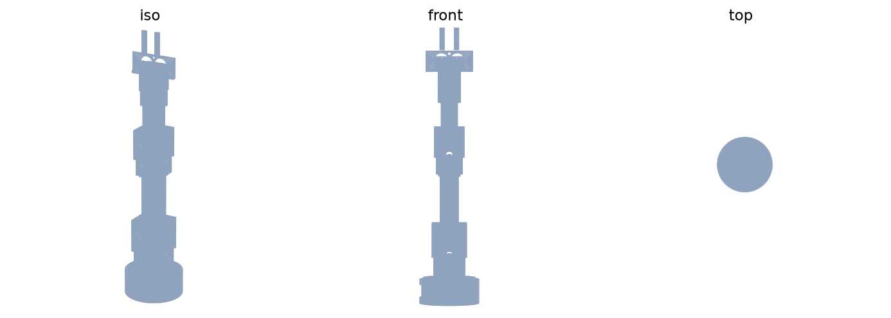

# SOMA — an arm that can feel, built as a body for an AI agent

> Working name: **SOMA** (rename before shipping if you want)

SOMA is a desk-scale robotic arm (~40 cm tall/reach) designed around one idea:
AI agents can already read your files and browse the web — but they're
disembodied. SOMA is a physical body built *for* an agent: it can see through a
camera in its face, feel through force-sensing joints and fingertips, speak
through a face and voice, and act through a compliant 5-axis arm with an
adaptive tendon-driven gripper.

Every cheap open-source arm today (SO-101, Koch, Moss, ~$120) is a numb
teleoperation peripheral: position in, position out, no sense of touch. Every
arm that can actually feel (OpenArm, ARX, reBot DM, Unitree Z1) starts at
$1,500+. SOMA sits in the gap: a sub-$500 arm with measured compliance, real
grip force in Newtons, tactile fingertips, and an onboard brain — designed to be
driven by an LLM agent rather than a robotics engineer.

## What it does

- **Moves**: 5 axes + gripper, ~400 mm reach, ~300 g rated payload, ~40 cm tall.
- **Yields and protects**: the two load-bearing joints (shoulder, elbow) are
  series-elastic — a printed torsion spring sits between the servo output and
  the link, with a magnetic encoder on the output side. Spring deflection gives
  true joint torque in N·m, and the controller relieves deflection by moving
  the joint — the arm physically gives when pushed instead of fighting you.
  Every joint additionally supports a software torque limit and a coast mode,
  so the whole arm is hand-guidable for teaching.
- **Knows how hard it grips**: a spring-loaded idler in the gripper tendon path
  deflects in proportion to tendon tension → calibrated grip force in Newtons.
  Closed-loop "grasp at 0.5 N" is a first-class API call, not a guess.
- **Feels its fingertips**: BMP390 barometric pressure sensors potted in
  silicone fingertip pads report contact pressure and slip (barometric tactile
  pads measured ~0.13 N mean error in published comparative testing — better
  accuracy per dollar than FSR).
- **Sees**: a camera mounted in the "face" module near the wrist — the agent
  looks directly at what it's manipulating.
- **Has a face and voice**: two round LCD eye displays + mic + speaker. The
  face is the agent's, not a status screen — it looks at things, emotes, and
  makes the embodiment legible.
- **Thinks**: an onboard Orange Pi 5 (6 TOPS NPU) runs the robot OS — control
  loops, vision, face rendering, and the agent-facing API. The heavy "mind"
  (the LLM agent) runs on your computer or in the cloud and drives the body
  over the network; the onboard NPU still gives the arm real-time vision even
  with the laptop closed.

## Why it exists

I want a robot arm that isn't another position-controlled clone. The
open-source arm ecosystem optimizes for teleoperation data collection, which
means nobody builds arms that can feel — because imitation learning pipelines
don't need them to. But an *agent* does: if an AI is going to pick up my pen,
hand me a cable, or sort my desk, it needs touch, force, compliance, and
safety, not just joint angles.

SOMA is also the build I couldn't buy: compliant + tactile + agent-native +
with a face, under $500.

## How you use it

**From an agent / your own code** — the arm exposes a small tool API over the
network (WebSocket/JSON) and an MCP server so any agent (Claude Desktop, a
custom LLM loop, scripts) can drive it:

| Tool | What it does |
|---|---|
| `move_joints(q, max_torque)` | Joint-space move with torque cap |
| `move_tcp(x, y, z, pitch, roll)` | Cartesian move (solved by onboard IK) |
| `grasp(force_n)` | Close gripper until target grip force |
| `sense()` | Joint positions, joint torques (N·m), tendon force, fingertip pressure, IMU |
| `look()` | Grab a frame from the face camera |
| `express(state)` | Eye animation / LED / voice cue |
| `guide(on/off)` | Torque-off coast mode — grab the arm and teach it a motion |
| `estop()` | Immediate torque-off + hold |

**By hand**: torque-off mode lets you pull the arm through a motion and record
it for replay (leader-arm teaching built into one arm — no second arm needed).

**Autonomous**: the agent loop — `look()` → plan → `move_tcp()` → `grasp(0.5)`
→ `sense()` — runs from whatever agent you point at it.

## Specs

| | |
|---|---|
| Axes | 5 DOF + underactuated tendon gripper (6 servos) — J6 wrist-yaw drop-in ready |
| Reach / height | ~400 mm reach, ~40 cm tall |
| Rated payload | ~300 g (see [torque analysis](docs/torque-analysis.md)) |
| Joint actuators | Hiwonder HTD-45H 45 kg·cm TTL (shoulder, + gravity-assist spring) + 5× STS3215-12V 30 kg·cm TTL (waist, elbow, wrist ×2, gripper) — all on one 12 V rail |
| Joint torque sensing | Series-elastic springs + output encoders on J2/J3; servo load/current telemetry on all joints |
| Grip force | Sprung tendon idler + encoder → calibrated N; fingertip BMP390 pads |
| Senses | Joint torque, grip force, fingertip pressure, IMU, camera, mic |
| Brain | Orange Pi 5B (4 GB, 6 TOPS NPU — optional) + ESP32-S3 real-time node + ESP32-S3-LCD wrist/face node |
| Face | 2× GC9A01 1.28" round LCD eyes at the wrist module |
| Interface | USB-C to host *or* network API + MCP server |
| Power | 12 V/8 A rail → all six servos; buck →5 V logic (single rail — no 7.4 V tap needed) |
| Est. build cost | **~$485 with onboard brain / ~$400 headless** — verified pricing, see [BOM](docs/BOM.md) |

## Images



> Remaining before design ship review:
> - [ ] Exploded view of shoulder SEA cartridge
> - [ ] Exploded view of wrist/face/gripper module
> - [ ] Wiring diagram (see docs/architecture.md for the netlist)
> - [ ] Cart screenshot of the BOM for the funding request

## Architecture (summary)

```
Your agent (Mac / cloud LLM)
        │  tools over LAN/WebSocket + MCP
        ▼
Orange Pi 5 ─── robot OS: IK, vision (NPU), face renderer, API server
        │  USB serial (JSON frames)
        ▼
ESP32-S3 (base) ── servo bus (UART half-duplex), SEA encoders, IMU,
        │           safety watchdog, joint torque estimator
        │  UART + 5V through arm harness
        ▼
ESP32 (wrist) ─── eye displays (SPI), BMP390 fingertip pads (I2C),
                    tendon-force encoder; USB camera passes through to Pi
```

Full detail: [docs/architecture.md](docs/architecture.md)

## Repo layout

```
soma/
├── README.md
├── docs/
│   ├── BOM.md                  # line-item bill of materials + alternates
│   ├── architecture.md         # electrical/software architecture + netlist
│   ├── torque-analysis.md      # worst-case joint torque budget
│   ├── submission-checklist.md # Fabricate design-ship requirements tracker
│   └── build-notes.md          # print settings + order of assembly
├── cad/
│   ├── assembly.py             # posed full build -> STEP/STL + preview.png
│   ├── lib/                    # parametric parts (servo, joint, SEA, case…)
│   └── export/                 # generated STLs + STEPs + render
├── pcb/                        # soma-carrier: 2-layer hand-solder base PCB
│   ├── gen_pcb.py              # board generator + grid A* router
│   ├── soma-carrier.kicad_pcb  # generated board (open in KiCad)
│   └── gerbers/                # fab outputs for JLCPCB/OSH Park
├── firmware/
│   ├── shared/                 # pure-C wire-protocol codecs (CAN/Feetech/link)
│   ├── base-node/              # ESP32-S3: CAN+Feetech buses, host link, watchdog
│   │                           #   (PlatformIO, v3 — see docs/bringup.md)
│   ├── joint-driver/           # B-G431B-ESC1 SimpleFOC joint drive (CAN)
│   └── wrist-node/             # (TODO) ESP32: eyes, tactile pads, tendon encoder
└── software/
    ├── robot-os/               # Pi: IK, planner, CLI, link client, simulator
    │                           #   (soma_arm package + tests — v3 Stream C)
    └── mcp-server/             # (TODO) agent tool interface
```

## Build phases (journal milestones)

1. **Skeleton** — printed arm, 6 servos on the bus, FK moves, URDF twin.
2. **Compliance** — SEA cartridges on J2/J3, torque calibration rig, admittance.
3. **Senses** — tendon-force idler, fingertip pads, IMU, camera.
4. **Person** — face module, voice, "look at what I'm holding" behaviors.
5. **Embodiment** — MCP tools, agent loop demos (egg pick, hand-guided teaching,
   grab-the-pen-you-dropped).

## License

Hardware: CERN-OHL-S-2.0 (planned). Software/firmware: Apache-2.0 (planned).
